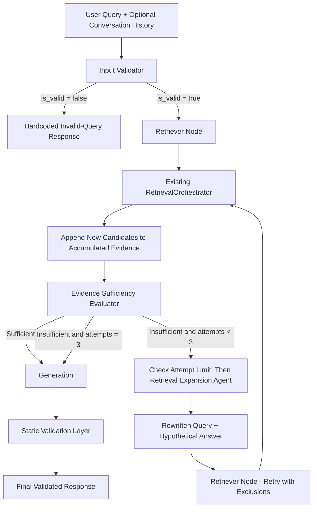

# SaviraCortex — Workflow Architecture Memory

> **Purpose:** This document is the agreed architectural reference for the end-to-end SaviraCortex RAG workflow. It records the decisions made during architecture discussions and is intended to guide implementation.
>
> **Status:** Architecture agreed; implementation of the end-to-end workflow has not yet started.
>
> **Scope:** Orchestration of input validation, retrieval, evidence sufficiency evaluation, iterative retrieval expansion, generation, and static validation. This document does not authorize changes to code by itself.

---

## 1. Architectural objective

Build a modular, end-to-end RAG workflow orchestrated with LangGraph. The workflow receives a user query and optional conversation history, retrieves company-document evidence, evaluates whether that evidence can answer the query, performs bounded iterative retrieval expansion when necessary, generates a grounded answer, and validates the generated structure and citation references before returning the final response.

The workflow must reuse the existing retrieval implementation. It must not introduce a second retrieval pipeline or duplicate retrieval responsibilities inside LangGraph.

The initial SaviraCortex chatbot is **company-document-grounded**, not a general-purpose assistant.

### Core principles

1. The original user query remains unchanged throughout the workflow.
2. Conversation history is optional and may be empty for a new conversation.
3. Retrieval and reranking remain the responsibility of the existing retrieval service.
4. LangGraph coordinates the stages and owns workflow state.
5. Evidence expansion is conditional: it runs only when the evaluator finds the current evidence insufficient.
6. There are at most **three total retrieval attempts**, including the initial attempt.
7. Evidence gathered across attempts is accumulated and made available to evaluation and generation.
8. Hypothetical answers are retrieval aids only. They are never factual evidence.
9. Generation must not invent company facts or use general-knowledge fallback for company-specific questions.
10. Static validation is deterministic Python validation; no second LLM citation-verification call is introduced.

---

## 2. High-level workflow

The agreed logical flow is:



The diagram describes the control flow. The detailed responsibilities and state transitions are defined below.

### Workflow stages

1. **Input Validator** — deterministic validation of the current user query.
2. **Retriever Node** — thin LangGraph node that invokes the existing retrieval orchestrator and updates graph state.
3. **RetrievalOrchestrator** — existing retrieval pipeline, reused for the first attempt and every retry.
4. **Evidence Sufficiency Evaluator** — assesses whether accumulated retrieved evidence can answer the original query.
5. **Retrieval Expansion Agent** — conditionally rewrites the retrieval query and generates a hypothetical answer to guide another retrieval attempt.
6. **Generation** — produces a company-grounded structured answer using the original query, optional history, and accumulated retrieved evidence.
7. **Static Validation Layer** — validates output schema and citation references deterministically before the result is returned.

---

## 3. Input contract and validation

### Inputs

The workflow receives:

- **Original query:** the current user query. This is the authoritative question for evaluation and final generation.
- **Conversation history:** optional ordered LangChain `HumanMessage` and `AIMessage` messages. It may be empty or absent.
- **Retrieval context:** authorization and other retrieval context required by the existing retrieval service, supplied by the application integration.

### Input Validator

- Implemented as a standalone deterministic Python function that accepts the query string.
- It performs the agreed length/meaningfulness checks and cleaning/normalization.
- It returns the cleaned query and an `is_valid` boolean.
- If `is_valid=True`, store/use the cleaned query in the single graph-state field `query` and continue to the Retriever Node.
- If `is_valid=False`, skip retrieval and return a predefined hardcoded invalid-query response asking the user to reformulate the request. No LLM call is needed for this response.
- Conversation history is optional and is not rejected merely because it is empty or absent.
- Do not add a separate LLM-based input-validation agent.

The `query` field remains the user query for evidence evaluation and Generation. Retrieval expansion must not overwrite it.

---

## 4. Reuse the existing RetrievalOrchestrator

### Non-negotiable design decision

There is **one retrieval pipeline**: the existing `RetrievalOrchestrator` in `app/services/retrieval/retrieval_service.py`.

The first retrieval and all subsequent retrieval attempts must invoke this same orchestrator and use the same retrieval stages. Do not create a second retriever, a special HyDE retriever, or a separate retry-only retrieval implementation.

The existing retrieval service is responsible for its established retrieval work, including the applicable query processing/expansion, dense and sparse or hybrid retrieval branches, fusion, reranking, adaptive selection, and returning selected candidates. The exact internal stage sequence remains defined by the current implementation.

LangGraph must not reimplement those stages.

### Proposed backward-compatible extension

The existing orchestrator is to be extended with two optional parameters:

```python
exclude: bool = False
excluded_chunk_ids: list[str] | None = None
```

These defaults preserve existing callers and first-attempt behavior.

| Invocation | `exclude` | `excluded_chunk_ids` |
|---|---:|---|
| Initial retrieval | `False` | `None` |
| Subsequent retrieval | `True` | Accumulated stable chunk IDs already retrieved |

The exclusion flag and IDs must be applied consistently across the relevant dense and sparse retrieval branches. Prefer applying exclusions as part of candidate retrieval/filtering, before candidate selection, rather than retrieving the same top candidates and removing them only after selection.

Exclusion is at the **chunk level**, not the whole-document level. A different chunk from a document already represented in prior evidence may still be useful.

The implementation must inspect the actual vector-store and sparse-retrieval interfaces before deciding how to express the exclusion filter. Do not assume both backends support identical filtering syntax. If a backend limitation requires a fallback, document it and agree on it before changing behavior.

### First attempt

- The Retriever Node passes the graph state's `query` to the existing retrieval API, subject to its supported context handling.
- Pass `exclude=False`.
- Pass `excluded_chunk_ids=None`.
- Receive the selected candidates from the existing orchestrator.

### Subsequent attempts

- The Retriever Node forms one retrieval input by combining `rewritten_query` and `hypothetical_answer`.
- Pass that combined retrieval input to the same existing retrieval API.
- Pass `exclude=True` and the cumulative list of stable chunk IDs already retrieved in previous attempts.
- Invoke the same orchestrator and same pipeline stages.
- Receive only the newly selected candidates, subject to the backend's exclusion behavior.

The combined retry input is local to the retrieval call; it does not replace or overwrite the graph state's `query`.

### Keep the responsibilities separate

**RetrievalOrchestrator:**
- Executes retrieval and returns its normal result structure.
- Applies exclusion when requested.
- Does not own LangGraph state or append to graph-state evidence.

**Retriever Node:**
- Reads the graph state.
- Determines whether this is the initial attempt or a retry.
- Calls the existing orchestrator with the appropriate query and exclusion arguments.
- Appends/merges returned candidates into accumulated evidence.
- Deduplicates by stable retrieval chunk ID.
- Updates cumulative excluded chunk IDs and the attempt counter.
- Resets the retry request after consuming it.

The retrieval service must remain independent of LangGraph.

---

## 5. Evidence accumulation and identity

The graph state owns the accumulated evidence across attempts.

For each retrieval call:

1. The orchestrator returns newly selected candidates in its existing result shape.
2. The Retriever Node merges those candidates with the evidence already in graph state.
3. Deduplication uses the stable chunk ID supplied by the retrieval system.
4. Preserve useful source metadata and provenance.
5. Preserve a deterministic evidence order so that downstream evidence IDs can be assigned consistently.
6. Update the cumulative set/list of stable chunk IDs used for exclusions on the next attempt.

Do not confuse two different kinds of identifiers:

- **Stable retrieval chunk IDs:** backend identifiers used for deduplication and exclusion between retrieval attempts.
- **Prompt-scoped evidence IDs:** identifiers such as `E1`, `E2` assigned when evidence is presented to Generation and used in the generated citations.

Prompt-scoped IDs are not substitutes for stable chunk IDs. They are request-scoped references, not persistent document identifiers.

The exact merge policy and ordering must be deterministic. Repeated chunks must not appear multiple times in accumulated evidence.

---

## 6. Evidence Sufficiency Evaluator

The evaluator decides whether the **accumulated retrieved evidence** is sufficient to answer the **original user query**.

### Inputs

- Original query.
- Optional conversation history.
- Accumulated retrieved documents/evidence.
- Retrieval attempt count and relevant workflow context.

The original query must remain the evaluation target, even after one or more retrieval rewrites.

### Outcomes

The evaluator must distinguish:

- **Sufficient:** the available evidence supports answering the query; proceed to Generation.
- **Insufficient:** evidence is missing, incomplete, or does not adequately cover the question; request retrieval expansion if attempts remain.
- **Insufficient after final attempt:** stop retrieval and proceed to Generation with all accumulated evidence. Do not force the evaluator to label weak evidence as sufficient just to continue.

For complex multi-part questions, the evaluator may identify missing aspects or retrieval facets. For example, a request comparing policies across multiple years may require evidence for several distinct periods. Missing facets can guide the Retrieval Expansion Agent.

The evaluator must not treat the hypothetical answer produced by the expansion agent as evidence. Only retrieved company documents count as evidence.

---

## 7. Retrieval Expansion Agent

### When it runs

The Retrieval Expansion Agent runs only when:

- the Evidence Sufficiency Evaluator reports insufficient evidence; and
- fewer than three total retrieval attempts have been made.

It is not part of every request and does not replace the initial retrieval.

### Inputs

- Original user query.
- Current retrieval query/representation.
- Optional conversation history.
- Accumulated retrieved documents.
- Missing information or facets identified by the evaluator.

### Outputs

The agent produces:

1. **Rewritten retrieval query:** a clearer or more targeted retrieval-oriented formulation of the original information need.
2. **Hypothetical answer:** a plausible answer to that rewritten query, generated to provide additional semantic retrieval context.

For multi-facet questions, the agent may produce multiple targeted query facets and corresponding hypothetical answers. These can be used to guide one subsequent retrieval attempt that executes the same existing retrieval pipeline over the targeted representations, subject to what the inspected retrieval interfaces support.

### Hypothetical answer, not hypothetical document

The agreed approach is to generate a **hypothetical answer**, not a hypothetical document.

This is HyDE-inspired query expansion, but it is not a separate document-generation, indexing, or ingestion workflow. No hypothetical document is stored or treated as a company source.

The hypothetical answer is synthetic retrieval guidance only:
- It must never be appended to the retrieved evidence.
- It must never be cited.
- It must never be passed to Generation as source evidence.
- It must never be used to claim that a company fact has been verified.

### Keep retrieval representations distinguishable

Although the rewritten query and hypothetical answer together describe the next retrieval intent, keep them distinguishable internally where the retrieval interfaces permit it.

Preferred direction:
- Rewritten query can support lexical/BM25 retrieval and query-oriented dense retrieval.
- Hypothetical answer can provide a separate semantic search representation.

Do not blindly concatenate both into one long text if the existing retrieval API can accept separate representations. However, do not create a second pipeline to achieve this. Inspect the current query and retrieval interfaces first, then choose the smallest compatible change. If the current interface only accepts one query string, document that constraint and agree on the least disruptive adaptation before implementation.

The graph state's `query` remains unchanged by retrieval expansion. On a retry, the Retriever Node combines `rewritten_query` and `hypothetical_answer` into the retrieval input for that call only. Evaluation and Generation continue to receive the user query, not this combined retrieval input.

---

## 8. Retry control and attempt limit

The maximum is **three total retrieval attempts**, not three retries after the initial attempt.

| Attempt | Action |
|---|---|
| 1 | Initial retrieval using the original query, with exclusion disabled |
| 2 | If insufficient, expand the retrieval query and retrieve again with prior chunk IDs excluded |
| 3 | If still insufficient, expand again and retrieve a final time with all previously retrieved chunk IDs excluded |

After attempt 3:
- Do not invoke the Retrieval Expansion Agent again.
- Do not perform a fourth retrieval.
- Proceed to Generation with accumulated evidence, even if the evidence evaluator found it insufficient.

### Retry and exclusion are different concepts

- `retry` is graph control state: it indicates that another retrieval attempt has been requested by the evaluator/conditional routing.
- `exclude` is a parameter for one call to the RetrievalOrchestrator: it controls whether previously retrieved chunk IDs are excluded in that call.

The Retriever Node checks the retry state:
- If `retry=False`, this is the initial retrieval call: pass `query`, use `exclude=False`, and pass no excluded IDs.
- If `retry=True`, this is a subsequent retrieval call: combine `rewritten_query` and `hypothetical_answer` as the retrieval input, use `exclude=True`, and pass accumulated `excluded_chunk_ids`.

After the requested retrieval has been executed and state updated, reset `retry=False`. The evaluator may set it to true again if another attempt is required and the attempt limit has not been reached. The `query` state field is never replaced by the combined retry input.

The attempt counter increments once per actual retrieval call, including the initial call. The graph's conditional routing must enforce the three-attempt maximum.

---

## 9. Generation

Generation receives:

- Original user query (never the rewritten retrieval query).
- Optional conversation history.
- Accumulated retrieved company-document evidence from all attempts.

Generation does not run retrieval, reranking, query expansion, or evidence deduplication. Those responsibilities belong upstream.

### Grounding policy

- Company-specific answers must be grounded in retrieved company evidence.
- Do not use general-knowledge fallback to answer company facts.
- Do not invent unsupported details.
- If evidence supports only part of the request, return a qualified partial answer.
- If evidence is inadequate, return an insufficient-evidence response.
- The hypothetical answer from Retrieval Expansion is not evidence and must not be included as a source.

### Existing Generation component

The existing Generation implementation is in `app/agents/Generation/` and uses `app/llm/generator_client.py`. It already defines structured answer output, evidence-scoped citation IDs, optional history handling, no-evidence behavior, and streaming support.

The workflow should integrate and reuse this component rather than recreate its functionality in a new graph node.

The existing output statuses are:
- `ANSWERED`
- `PARTIAL`
- `INSUFFICIENT_EVIDENCE`

The exact Generation input contract should be confirmed against the current implementation during integration.

---

## 10. Static Validation Layer

After Generation, run deterministic static validation before returning the response.

Reuse the existing implementation in `app/validation/`.

Responsibilities include:
- Validate/parse the structured Generation output against its schema.
- Validate citation evidence-ID format.
- Verify every cited evidence ID exists in the request's evidence registry.
- Reject citations on an `INSUFFICIENT_EVIDENCE` output, according to the existing validation contract.
- Build trusted citation metadata from the same ordered retrieved candidates used to construct Generation evidence.
- Return validation errors/warnings and resolved citation metadata according to the existing result schema.

The evidence registry and Generation prompt must use the same evidence ordering and eligibility rules so that `E1`, `E2`, etc. resolve to the intended retrieved chunks.

### What static validation does not do

- It does not use another LLM call.
- It does not prove semantic entailment between a cited source and a claim.
- It does not generate URLs.
- It does not authorize access to private documents.
- It does not replace application-level document authorization.

A citation ID passing static validation means that the reference exists in the current request's evidence registry; it does not independently prove that the cited passage semantically supports the statement.

Only return the final response after successful validation according to the application's error-handling policy. Validation failures must not be silently presented as validated output.

---

## 11. Graph state — agreed variable contract

The following variable names and responsibilities were agreed during the node-by-node architecture discussion. This is the graph-state contract to use when implementation is authorized; the concrete Python `TypedDict` or other state representation should follow the project's conventions.

| State field | Type / shape | Purpose |
|---|---|---|
| `query` | `str` | The single user-query field. The Input Validator may clean/normalize it; retrieval expansion must not overwrite it. There is no separate `original_query` or `current_query` state variable. |
| `context` | `list[BaseMessage] \| None` | Optional ordered LangChain conversation history. It may be absent or empty. |
| `organization_id` | `UUID` | Organization/tenant context required by the existing retrieval service. |
| `user_id` | `UUID` | User identity required by the existing retrieval service. |
| `is_valid` | `bool` | Input Validator result. False routes directly to a predefined hardcoded invalid-query response; true continues to retrieval. |
| `retrieved_documents` | `list[dict]` | Accumulated, deduplicated real retrieved candidates from all retrieval attempts. |
| `excluded_chunk_ids` | `list[str]` | Stable chunk IDs already retrieved and supplied for exclusion on subsequent attempts. |
| `exclude` | `bool` | Whether the current RetrievalOrchestrator call should exclude previously retrieved chunks. False on the initial attempt; true on retries. |
| `retrieval_attempt` | `int` | Number of actual RetrievalOrchestrator calls completed, including the initial call. |
| `is_sufficient` | `bool \| None` | Evidence Sufficiency Evaluator's decision about the accumulated retrieved evidence. |
| `missing_information` | `list[str]` | Optional missing aspects/facets identified by the evaluator and used by Retrieval Expansion Agent. |
| `rewritten_query` | `str \| None` | Retrieval Expansion Agent's rewritten retrieval query. |
| `hypothetical_answer` | `str \| None` | Synthetic answer generated as a retrieval aid only; never evidence or a Generation source. |
| `retry` | `bool` | Graph-control flag indicating that another evidence-retrieval attempt has been requested. Distinct from the per-call `exclude` flag. |
| `generation_output` | `GenerationOutput \| None` | Structured output from the existing Generation component. |
| `validation_result` | `GenerationValidationResult \| None` | Result from the existing Static Validation Layer. |
| `errors` | `list[str]` | Explicit workflow errors, if any. |
| `retrieval_diagnostics` | `dict \| None` | Optional diagnostics returned by the retrieval service for observability. |

### Query selection inside the Retriever Node

Do not store duplicate query fields in graph state. The Retriever Node chooses the query string for each service call:

- When `exclude=False` (initial retrieval), pass `query` to the existing RetrievalOrchestrator.
- When `exclude=True` (subsequent retrieval), pass a combined retrieval string formed from `rewritten_query` and `hypothetical_answer`, and pass `excluded_chunk_ids` as well.
- Keep `query` unchanged by retrieval expansion. Evidence evaluation and Generation continue to use this user query, not the combined retrieval representation.

The `retry` flag controls graph routing; the Retriever Node uses it/attempt context to select the retry behavior and sets the per-call `exclude` value accordingly. After consuming a retry request, reset `retry=False`.

### Retry-limit configuration

The maximum of three total retrieval attempts is configuration, not mutable graph state. Do not add `max_retrieval_attempts` to the state. Import the configured value from the project's `app.config.py` if that setting exists; otherwise define a single configuration constant in the appropriate existing configuration module. The graph must check the attempt limit before invoking Retrieval Expansion Agent, so no expansion LLM call is wasted when no further retrieval attempt is allowed.

State updates should be explicit and owned by the appropriate node. Do not place LangGraph state ownership inside the RetrievalOrchestrator.

---

## 12. Conditional routing

The intended routing logic is:

1. Start → Input Validator.
2. If `is_valid=True`, continue to Retriever Node.
3. If `is_valid=False`, skip retrieval and return the predefined hardcoded invalid-query response.
4. Retriever Node → Evidence Sufficiency Evaluator.
5. If sufficient → Generation.
6. If insufficient and attempt count is less than 3 → check the attempt limit first, then invoke Retrieval Expansion Agent → Retriever Node.
7. If insufficient and attempt count equals 3 → skip Retrieval Expansion Agent and proceed to Generation with accumulated evidence.
8. Generation → Static Validation Layer.
9. Successful validation → final response.

The three-attempt check must happen before invoking Retrieval Expansion Agent. Invalid input must never proceed to retrieval.

Operational failures (retrieval errors, evaluator/expansion errors, Generation errors, and validation errors) must be represented explicitly. Do not silently convert an infrastructure or parsing failure into a successful answer or into an ordinary insufficient-evidence result. Retry policies for transient infrastructure errors are separate from the three-attempt **evidence retrieval** limit and must be designed explicitly rather than accidentally increasing the retrieval-attempt count.

---

## 13. Context compression — future conditional component

Context compression/refinement is a possible future component, not a mandatory stage in the first implementation.

It should be considered when the estimated token budget of accumulated evidence approaches the Generation context limit. Do not trigger compression merely because the number of chunks crosses an arbitrary threshold.

Any future compression must preserve:
- Evidence IDs and the mapping back to original retrieved chunks.
- Source provenance and document metadata.
- Relevant dates and versions.
- Conditions, exceptions, qualifications, and historical distinctions.
- The ability to cite the original source evidence.

This is particularly important for multi-year or historical comparisons. Compression must not merge away meaningful differences between policy versions or remove caveats that change the answer.

The initial implementation should prioritize a correct, traceable evidence flow. Add compression only when token-budget needs and tests justify it.

---

## 14. Private document citations and access — downstream design

The Generation/Static Validation contract uses evidence IDs and trusted metadata. It must not allow the LLM to invent document URLs.

For future end-user citation access:
- The model emits evidence IDs only.
- Backend code resolves IDs through the request-scoped trusted evidence registry.
- Backend maps the citation to an authenticated application document route.
- Private storage buckets remain private.
- Every document open must perform authentication and document-level authorization.
- A logged-out/expired session should receive an authentication failure; an authenticated user without access should receive a forbidden response; missing resources should not be exposed as accessible.
- Prefer an authenticated application document gateway that streams the authorized document into an in-app viewer.
- A side-panel viewer with page navigation is the preferred user experience where supported.
- Temporary signed URLs are optional internal infrastructure, not the preferred browser-facing citation contract, because they act as bearer capabilities until expiry.

This access/viewer work is downstream of the initial graph implementation and must be integrated with the actual frontend and authorization model.

---

## 15. Streaming and API integration — staged work

The existing Generation component has streaming support, but the first end-to-end graph integration should establish a correct non-streaming workflow contract before adding graph-level streaming.

Recommended staged sequence:

1. Define and test graph state and node contracts.
2. Integrate the existing retrieval service and bounded retry loop.
3. Integrate Generation and Static Validation.
4. Add graph-level integration tests for routing, evidence accumulation, exclusions, and attempt limits.
5. Add streaming through the graph while preserving event ordering and validated completion semantics.
6. Expose the workflow through application/API routes.
7. Integrate frontend response rendering and authenticated citation viewing.

Streaming must not expose an unvalidated result as completed. Provisional deltas and validated completion must remain distinguishable. The existing Generation stream uses segment indices; consumers must preserve segment boundaries rather than assuming all deltas can be concatenated without separators.

---

## 16. Implementation boundaries

### Reuse existing components

- Existing `RetrievalOrchestrator` in `app/services/retrieval/retrieval_service.py`.
- Existing Generation agent in `app/agents/Generation/`.
- Existing LLM client in `app/llm/generator_client.py`.
- Existing Static Validation Layer in `app/validation/`.

### New orchestration responsibilities

The LangGraph workflow should own:
- Typed graph state.
- Input validation node.
- Retriever wrapper node.
- Evidence sufficiency evaluation node/agent.
- Retrieval expansion node/agent.
- Conditional routing and attempt-limit enforcement.
- Evidence accumulation and stable-ID deduplication.
- Generation integration node.
- Static validation integration node.
- Explicit error propagation and graph-level tests.

### Do not build

- A second retrieval pipeline.
- A separate hypothetical-document creation/indexing pipeline.
- A second LLM call solely to validate citations.
- A general-knowledge router/fallback for company facts.
- Duplicate retrieval, reranking, or adaptive top-K logic inside LangGraph.
- A Generation node that treats hypothetical answers as evidence.

---

## 17. Decisions that must be verified during implementation

The architecture is agreed, but these implementation details require code inspection before making changes:

1. The exact current `RetrievalOrchestrator.retrieve(...)` signature and how its query/context inputs are represented.
2. How dense and sparse backends accept metadata filters or exclusions, and whether stable chunk IDs are available to both.
3. Whether the current retrieval pipeline can accept separate lexical query and semantic hypothetical-answer representations without duplicating stages.
4. The exact candidate result shape and stable chunk-ID field used for deduplication.
5. How the evaluator should represent sufficiency and missing facets in a typed, testable result.
6. The exact LangGraph state and node contracts.
7. How the existing Generation and Static Validation components should share evidence ordering and evidence-ID assignment without drift.
8. The application's authorization context and error-handling conventions.

Any proposed change to the agreed behavior should be discussed before implementation. In particular, do not silently change the one-pipeline rule, the three-total-attempt limit, the use of hypothetical answers, or the distinction between stable chunk IDs and prompt-scoped evidence IDs.

---

## 18. Recommended implementation order

1. Inspect current retrieval interfaces and candidate identity fields.
2. Agree on the smallest backward-compatible exclusion change to the existing RetrievalOrchestrator and its dense/sparse branches.
3. Define typed graph state and node input/output contracts.
4. Implement the Input Validator and Retriever Node.
5. Implement evidence accumulation, stable-ID deduplication, and retry/attempt accounting.
6. Implement the Evidence Sufficiency Evaluator and conditional routing.
7. Implement the Retrieval Expansion Agent with rewritten query and hypothetical answer.
8. Integrate existing Generation.
9. Integrate existing Static Validation Layer.
10. Add focused unit and graph integration tests, including:
    - empty/absent conversation history;
    - sufficient evidence after first retrieval;
    - insufficient first attempt followed by a successful retry;
    - multiple retries with exclusion IDs accumulated correctly;
    - no duplicate chunks in accumulated evidence;
    - exactly three maximum total retrieval attempts;
    - third attempt insufficient, then Generation still runs;
    - hypothetical answer never appears in the evidence registry or citations;
    - original query remains unchanged;
    - invalid citation IDs fail static validation;
    - retrieval/LLM/validation failures are surfaced explicitly.
11. Establish non-streaming end-to-end behavior before graph streaming.
12. Add API and frontend integration, including private citation access, as separate downstream stages.

---

## 19. Final agreed architecture in one paragraph

SaviraCortex will use a LangGraph-orchestrated, company-grounded RAG workflow that validates the current query deterministically, invokes the existing RetrievalOrchestrator for an initial retrieval, evaluates the accumulated company-document evidence against the unchanged original query, and—only when evidence is insufficient and fewer than three total retrieval attempts have occurred—uses a Retrieval Expansion Agent to produce a rewritten retrieval query and a hypothetical answer as retrieval-only guidance. Every attempt reuses the same RetrievalOrchestrator, with backward-compatible exclusion parameters enabled on retries to avoid retrieving previously seen stable chunk IDs. The Retriever Node owns evidence accumulation and deduplication in graph state. After sufficient evidence or the third attempt, the existing Generation component produces an answer grounded only in retrieved evidence, and the existing deterministic Static Validation Layer validates the output schema and citation references before a final response is returned. Context compression, graph streaming, API/frontend integration, and authenticated document viewing are staged follow-on capabilities, not reasons to split or duplicate the core retrieval pipeline.
