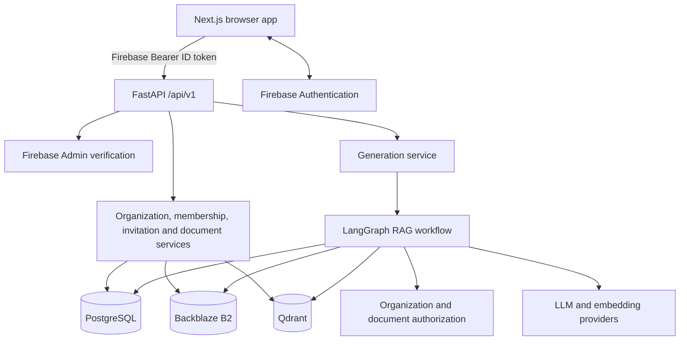

# 2. System Architecture

**Product:** SaviraCortex  
**Checkpoint:** 7 November 2026

## 2.1 Architectural style

SaviraCortex is a modular full-stack application. The backend separates FastAPI routing, Pydantic schemas, domain services, repositories, SQLAlchemy models, RAG components, LLM agents and external infrastructure clients. The frontend is a Next.js App Router application.

HTTP endpoints should remain thin. Endpoints parse requests, resolve dependencies and translate service results/errors into HTTP responses. Services own domain authorization and transaction behavior; repositories own relational query/persistence details.

## 2.2 Logical architecture



This is a logical component view, not a deployment topology.

## 2.3 Application and API

- Entry point: `backend/app/main.py`.
- FastAPI title: `SaviraCortex API`, version `1.0.0`.
- API router prefix: `/api/v1`.
- OpenAPI JSON: `/api/v1/openapi.json`.
- Swagger UI: `/api/v1/docs`.
- ReDoc: `/api/v1/redoc`.

The router currently includes home, health, auth, organizations, custom roles, organization memberships, departments, department memberships, invitations, document ingestion, document management and generation.

See [31 — Project-Wide Current State](31-project-wide-current-state.md) for route families and exact document/generation routes. The live OpenAPI schema is the contract authority for the running build.

## 2.4 Authentication and request lifecycle

1. Frontend obtains a Firebase ID token.
2. It sends `Authorization: Bearer <firebase-id-token>`.
3. `get_verified_firebase_claims` verifies the token through Firebase Admin.
4. Endpoint dependencies provide the database session and verified claims.
5. Services resolve the Firebase UID to a SaviraCortex user and verify organization membership/role.
6. Document operations additionally enforce the applicable document access policy.
7. Services commit/rollback relational transactions explicitly.
8. FastAPI serializes the response or streams SSE events.

A valid Firebase identity does not grant access to an organization unless application membership checks pass.

## 2.5 Data and AI infrastructure

- **PostgreSQL:** users, organizations, memberships, departments, custom roles, invitations, ACLs, documents, versions and ingestion sessions.
- **Qdrant:** document chunk vectors and summary vectors.
- **Backblaze B2:** original PDF objects through S3-compatible APIs.
- **Redis-compatible service:** cache functionality; do not assume every retrieval path uses the cache wrapper.
- **Firebase Authentication/Admin:** browser identity and backend token verification.
- **LLM/embedding/OCR providers:** processing and generation dependencies.

## 2.6 Main workflows

### Ingestion and indexing
The ingestion service analyzes/stages or streams PDF uploads, persists confirmed document/version metadata, stores the source file, and coordinates indexing. A version should become active only after successful indexing. Failed indexing should remain retryable.

### Document management and deletion
Document library operations span relational metadata, B2 source objects and Qdrant indexes. These stores do not share a distributed transaction. Cleanup order, idempotency and retry behavior are therefore important. Do not claim permanent deletion is atomic across all stores.

### Retrieval and generation
The RAG graph validates the query, retrieves organization/user-authorized evidence, evaluates sufficiency, optionally expands retrieval and compresses context, generates an answer, then validates output/citations. The generation API supports both ordinary JSON response and SSE streaming.

## 2.7 Runtime commands

Backend:

```powershell
cd E:\SaviraCortex\backend
uv run uvicorn app.main:app --reload
```

Frontend:

```powershell
cd E:\SaviraCortex\frontend
npm run dev
```

Configuration and external-service requirements are documented in [05 — Configuration](05-configuration.md) and [22 — Setup Guide](22-setup-guide.md).
