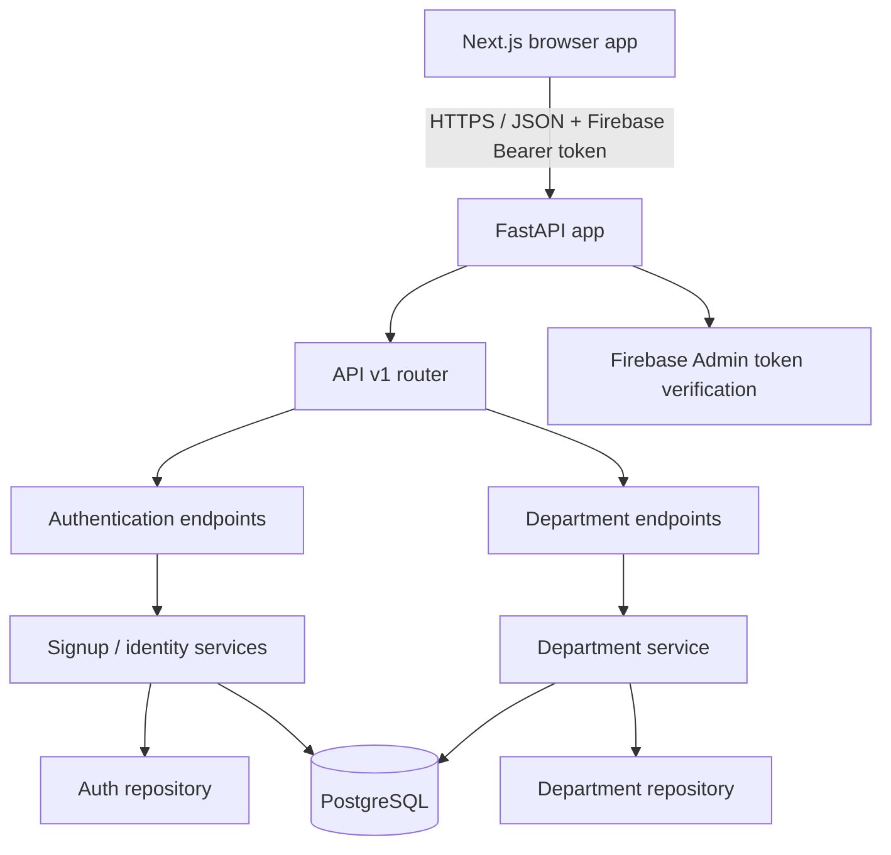
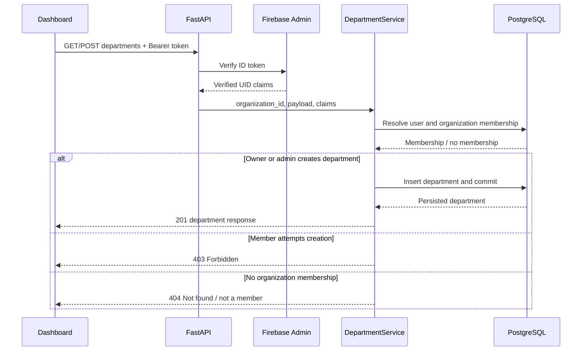

# 2. System Architecture

**Product:** SaviraCortex  
**Checkpoint:** 5 November 2026

## 2.1 Architectural style

SaviraCortex is a modular full-stack application. The backend separates FastAPI routing, Pydantic schemas, business services, repositories, SQLAlchemy models, RAG components, LLM agents and external infrastructure clients. The frontend is a Next.js App Router application.

The HTTP layer is deliberately thin: endpoint functions validate/deserialize requests, resolve dependencies and delegate business operations to services. Services own authorization decisions and transaction behavior; repositories own database queries and persistence.

## 2.2 Backend request architecture



### Application entry point
- Entry point: `backend/app/main.py`.
- FastAPI title: `SaviraCortex API`, version `1.0.0`.
- API router prefix: `/api/v1`.
- OpenAPI JSON: `/api/v1/openapi.json`.
- Swagger UI: `/api/v1/docs`.
- ReDoc: `/api/v1/redoc`.
- Local CORS origins include `http://localhost:3000` and `http://127.0.0.1:3000`.

### Current API routes
| Method | Route | Responsibility |
|---|---|---|
| GET | `/api/v1/health` | Health endpoint |
| GET | `/api/v1/auth/me` | Resolve authenticated SaviraCortex profile and organization memberships |
| POST | `/api/v1/auth/organizations/signup` | Register an organization and its initial administrator |
| GET | `/api/v1/organizations/{organization_id}/departments` | List departments after membership verification |
| POST | `/api/v1/organizations/{organization_id}/departments` | Create a department for an owner/admin |

The home endpoint is also registered. Consult the endpoint modules and generated OpenAPI schema for the precise current response contract.

## 2.3 Authentication and request lifecycle

1. The frontend obtains a Firebase ID token.
2. It sends `Authorization: Bearer <firebase-id-token>`.
3. `get_verified_firebase_claims` verifies the token through Firebase Admin.
4. Endpoint dependencies provide the SQLAlchemy session and verified claims.
5. The service maps the Firebase `uid` to a SaviraCortex user and checks organization membership/role as required.
6. The service commits or rolls back its transaction explicitly.
7. FastAPI serializes the Pydantic response.

Firebase token verification is not a substitute for application membership authorization. A valid Firebase account that has no SaviraCortex user or organization membership must not gain access to organization data.

## 2.4 Data and AI infrastructure

- **PostgreSQL:** users, organizations, memberships, departments, roles, ACLs, documents and document versions.
- **Qdrant:** chunk vectors and document-summary vectors.
- **Backblaze B2:** original PDF objects, accessed through S3-compatible APIs.
- **Redis-compatible service:** separate authorization cache helper; the current retrieval orchestrator has historically called AuthorizationService directly rather than using that cache wrapper.
- **Firebase Authentication:** external identity provider and Firebase Admin token verification.

The document ingestion, indexing and RAG architecture remains modular and is described in documents 08–19 and 26–29.

## 2.5 Department request flow



## 2.6 Transaction and cross-store boundaries

PostgreSQL transactions do not form a distributed transaction with Qdrant, Firebase or object storage. Ingestion/indexing workflows must retain their explicit cleanup and reconciliation behavior. The department creation service commits the department row and rolls back on integrity or other database errors.

## 2.7 Runtime commands

From the repository's backend directory:

```powershell
uvicorn app.main:app --reload
```

From the frontend directory:

```powershell
npm run dev
```

The frontend expects the backend base URL from `NEXT_PUBLIC_API_BASE_URL`, defaulting in the current pages to `http://localhost:8000`.
