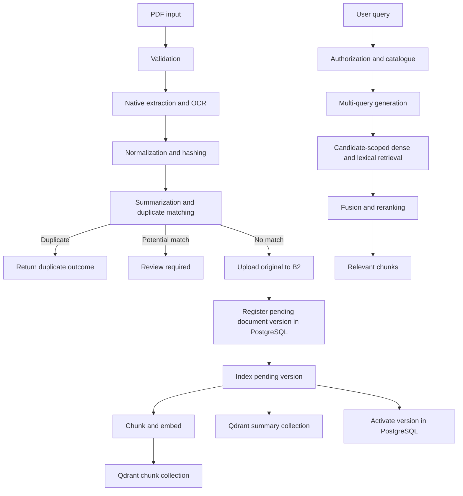

# 2. System Architecture

## 2.1 Architectural style

The implementation is organized as a modular Python application with service orchestration, repositories for relational persistence, RAG adapters, LLM clients, and external infrastructure clients. The modules are callable directly; a fully wired web/API composition layer is not present in the reviewed source.

## 2.2 Logical components

| Component | Responsibility | Main location |
|---|---|---|
| Configuration | Load environment configuration | `app/core/config.py` |
| Relational persistence | SQLAlchemy engine, sessions and models | `app/core/database.py`, `app/models/` |
| Authorization | Resolve organization document access and cache scopes | `app/services/authorization/` |
| PDF reader | Validate, extract and OCR pages | `app/rag/pdf_reader/` |
| Ingestion utilities | Normalize, sample and hash content | `app/rag/ingestion/` |
| LLM agents | Summarize documents and generate query variants | `app/agents/` |
| LLM clients | Construct configured chat models | `app/llm/` |
| Ingestion services | Match, upload and register incoming documents | `app/services/document_ingestion/` |
| Indexing services | Chunk, embed, persist and activate versions | `app/services/document_indexing/` |
| Vector stores | Qdrant chunk and summary collections | `app/rag/vector_stores/` |
| Retrieval | Candidate generation, hybrid search and ranking | `app/rag/retrieval/` |
| Object storage | Original PDF persistence | `app/storage/` |

## 2.3 Data stores

- **PostgreSQL:** organizations, users, memberships, roles, departments, ACL rules, documents and versions.
- **Qdrant:** chunk vectors/payloads and document-summary vectors in separately configured collections.
- **Backblaze B2:** original PDF objects, accessed using an S3-compatible client.
- **Redis-compatible service (Valkey in code comments):** authorization/catalogue cache.
- **SQLite artifact:** `data/bm25_index.sqlite3` exists in the repository; do not assume it is the authoritative lexical retrieval store. The retrieval code includes Qdrant BM25 support.

## 2.4 High-level data flow

## 2.5 Transaction and cross-store boundaries

The relational database transaction and external object/vector stores do not share a distributed transaction. Ingestion code attempts cleanup when upload or registration fails. Indexing orchestration uses database commit/rollback and separately synchronizes Qdrant lifecycle state and summary records. A lifecycle reconciler exists to repair certain cross-store inconsistencies.

Operationally, this means partial failure is possible: a database state can commit while an external synchronization is pending, or an uploaded object may require cleanup after a database failure. See [Error Handling](24-error-handling.md).

## 2.6 Runtime composition limitation

The repository's top-level `main.py` prints a greeting, while `app/main.py` prints `hi`. The API directory is empty. Therefore, this architecture describes the modules and their service-level workflows, not a fully running server process or deployed topology.
