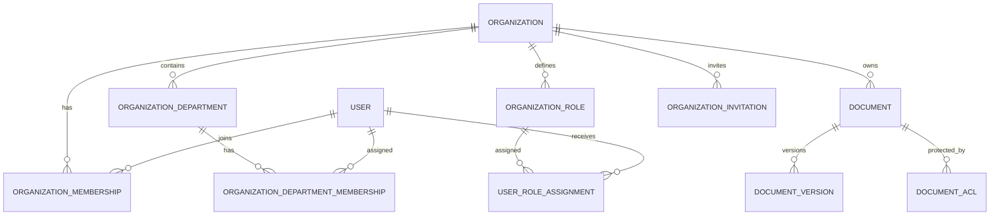

# 6. Database Design

## Persistence

The relational layer uses SQLAlchemy declarative models and a shared `Base`. The engine is configured through backend settings. Sessions are created through `app/core/database.py`; session dependencies close sessions, while services own transaction commits and rollbacks.

## Current model catalogue

The current `app/models/__init__.py` exports:

| Model | Responsibility |
|---|---|
| User | SaviraCortex user linked to a Firebase UID |
| Organization | Tenant/organization boundary |
| OrganizationMembership | User membership and organization-level role |
| OrganizationDepartment | Department belonging to an organization |
| OrganizationDepartmentMembership | User-to-department assignment |
| OrganizationRole | Organization-defined custom role |
| UserRoleAssignment | Assigns custom organization roles to a user |
| Document | Stable logical document identity and organization ownership |
| DocumentVersion | Version-specific file metadata, hashes, summary and lifecycle status |
| DocumentACL | Explicit access rules for user, role or department principals |
| OrganizationInvitation | Invitation token metadata and lifecycle |
| DocumentIngestionSession | Staged document ingestion state |

Consult model declarations for exact foreign keys, nullability, indexes, uniqueness and cascade behavior.

## Organization and department relationships

## Document and version distinction

A document is the stable logical identity. A document version represents one uploaded file revision and carries version-specific metadata such as original filename, storage key, hashes, summary, page count, version number and status. Version lifecycle and active-version constraints are defined in the model/service implementation.

Archiving is a logical-document state and should not be confused with a version status. Superseding creates a new version under the logical document; it is not the same as creating a new unrelated document.

## Schema creation and database-reset policy

`create_tables()` imports the model package and calls `Base.metadata.create_all()`. This creates missing registered tables; it does **not** alter existing table definitions or safely migrate an existing schema. The repository contains reset scripts that may drop data.

Project-owner instruction: do not introduce or run migrations without explicit approval. If a future feature requires a database schema change, update the SQLAlchemy models and model registration, explain the schema impact, and ask the owner to reset the currently empty development database if they approve. Never execute a destructive reset automatically.

The document-library documentation refresh does not add or alter database tables; no database reset is required for this documentation work.

## Transaction and cross-store conventions

Services explicitly call `commit`, `rollback` or `flush` according to workflow. PostgreSQL transactions do not include Firebase, B2 or Qdrant. Ingestion and permanent deletion must therefore handle partial external failures with retryable/idempotent operations and clear failure reporting.
