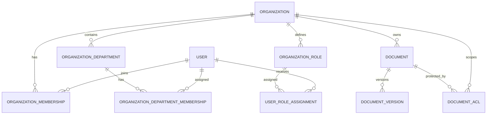

# 6. Database Design

## Persistence

The relational layer uses SQLAlchemy declarative models, a shared `Base`, an engine created from `AIVEN_POSTGRES_URI`, and a `SessionLocal` factory. Sessions use `autoflush=False` and `expire_on_commit=False`. `get_db_session()` yields a session, rolls back when an exception escapes, and always closes it. It does not automatically commit; transaction ownership remains with the calling service/repository.

## Entity catalogue

| Model | Responsibility |
|---|---|
| User | User identity |
| Organization | Tenant/organization boundary |
| OrganizationMembership | User membership and organization membership role |
| OrganizationDepartment | Departments within an organization |
| OrganizationDepartmentMembership | User-to-department membership |
| OrganizationRole | Organization-defined roles |
| UserRoleAssignment | Assigns an organization role to a user |
| DepartmentAccessPolicy | Department-related access policy data |
| Document | Logical document identity and organization ownership |
| DocumentVersion | Version-specific file metadata, hashes, summary, page count and lifecycle status |
| DocumentACL | Explicit allow/deny rules for user, role or department principals |

## Logical relationships

This is a conceptual diagram. Consult SQLAlchemy declarations for exact foreign keys, uniqueness constraints, indexes, nullability and cascade behavior.

## Document and version distinction

A document is the stable logical identity. A document version represents one uploaded file revision and carries file-specific information such as original filename, storage key, hashes, summary, page count, version number and status. This separation enables a newer version to replace an active version while historical versions remain available, subject to archive and access rules.

## Version states

The service and repository code uses `pending`, `active`, and `superseded` statuses. Archiving is represented on the logical document and does not itself rewrite version status. Archived documents are excluded from retrieval eligibility, while hash lookup may still find their versions to prevent duplicate re-registration.

## Schema creation and migrations

`create_tables()` imports models to register metadata and calls `Base.metadata.create_all()`. This creates missing tables but does not alter existing table definitions. The repository's `migrations/` directory was empty at review time; no checked-in migration history was present there. `create_all` is not a schema migration mechanism.

## Transaction conventions

Services explicitly call `commit`, `rollback`, or `flush` depending on workflow. `flush` sends pending ORM changes to the current transaction without committing it. Do not assume repository methods commit automatically; inspect the caller and implementation.