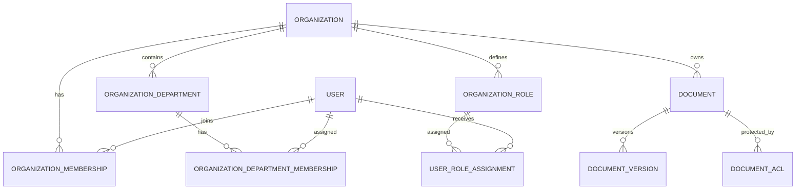

# 6. Database Design

## Persistence

The relational layer uses SQLAlchemy declarative models and a shared `Base`. The database engine is configured through the backend settings (PostgreSQL connection configuration). Sessions are created through the shared database module. Session dependencies yield a session and close it; services own transaction commits and rollbacks.

## Entity catalogue

| Model | Responsibility |
|---|---|
| User | SaviraCortex user linked to a Firebase UID |
| Organization | Tenant/organization boundary |
| OrganizationMembership | User membership and organization-level role |
| OrganizationDepartment | Department belonging to an organization |
| OrganizationDepartmentMembership | User-to-department assignment |
| OrganizationRole | Organization-defined roles |
| UserRoleAssignment | Assigns an organization role to a user |
| DepartmentAccessPolicy | Department/role policy model |
| Document | Logical document identity and organization ownership |
| DocumentVersion | Version-specific file metadata, hashes, summary, page count and lifecycle status |
| DocumentACL | Explicit allow/deny rules for user, role or department principals |

Consult SQLAlchemy model declarations for exact foreign keys, nullability, indexes, uniqueness and cascade behavior. A model file existing on disk does not by itself prove that its table is registered in imported metadata or that a deployed database has the corresponding schema.

## Organization and department relationships

### Department persistence contract

The department feature reuses the existing `OrganizationDepartment` entity/table; it does not introduce a second department table.

- A department belongs to one organization through `organization_id`.
- The department stores a name, optional description and creation timestamp.
- Department names are unique within an organization, not globally.
- The existing `OrganizationDepartmentMembership` relationship remains the mechanism for assigning users to departments; the current department form does not yet assign members.
- Department creation is committed by `DepartmentService`. An integrity error is rolled back and translated into HTTP 409.

## Document and version distinction

A document is the stable logical identity. A document version represents one uploaded file revision and carries file-specific information such as original filename, storage key, hashes, summary, page count, version number and status. The model enforces unique version numbers per document and at most one active version per document through a partial unique index where supported.

## Version states

The service and repository code uses `pending`, `active`, and `superseded` statuses. Archiving is represented on the logical document and does not itself rewrite version status. Archived documents are excluded from authorization catalogues/retrieval eligibility.

## Schema creation and migrations

The `migrations/` directory and actual database schema must be checked before assuming a new or modified table is present. SQLAlchemy `create_all()` creates missing tables known to imported metadata; it does not alter existing table definitions. The legacy database reset script is destructive and must not be used as a routine migration command.

## Transaction conventions

Services explicitly call `commit`, `rollback`, or `flush` depending on workflow. A repository's `add` operation does not imply a commit. For department creation, the service owns the transaction and performs rollback on failure.
