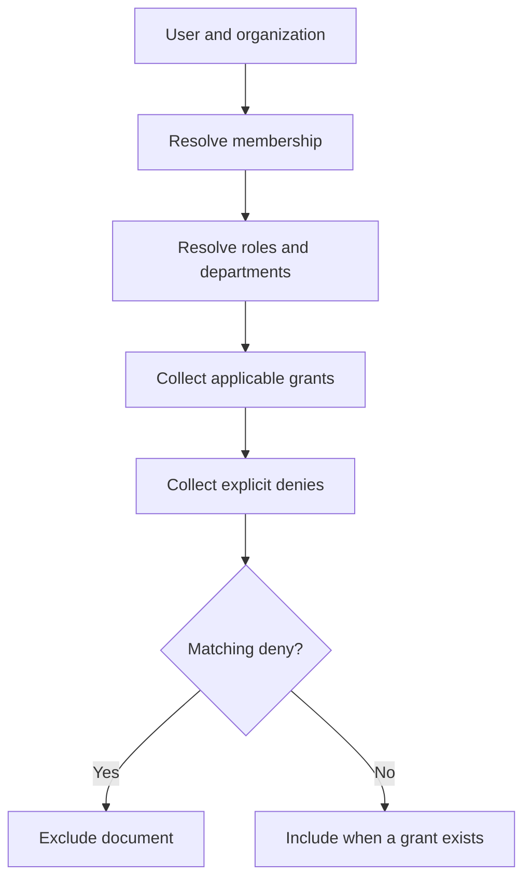

# 7. Authorization

Authorization is organization-scoped. The authorization repository computes document IDs available to a user within an organization; authorization services and their cache layer expose this scope to retrieval. The reviewed repository does not include HTTP authentication middleware, so callers must supply trusted organization and user identifiers.

## Access sources

The implementation and tests cover organization owner implicit access, direct user ACL grants, role grants for roles assigned to the user, department ACL grants, and department-based access where a document belongs to one of the user's departments. Explicit deny rules override matching grants, including owner implicit access. A member without applicable grants, department access or owner privilege receives no document access in tested behavior.

## Decision model

## Cache and retrieval enforcement

`AuthorizationCacheService` and `AuthorizationService` separate scope resolution from cached access/catalogue retrieval. Redis is accessed asynchronously through `app/core/redis.py`. Cache invalidation must follow membership, role, department and ACL changes. Retrieval candidate generation is constrained by authorized document IDs and the available document/version catalogue; vector similarity is not authorization.

## Security requirements

- Authenticate callers before passing identifiers to service methods.
- Preserve tenant scoping in relational and vector-store filters.
- Preserve deny-overrides-allow behavior.
- Invalidate cached scopes after permission changes.
- Avoid logging document text or sensitive identity data.
