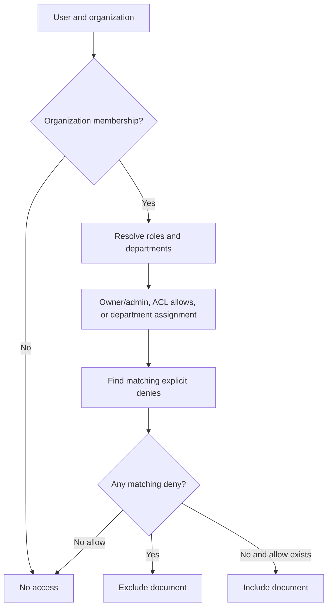

# 7. Authorization

Authorization is organization-scoped. `AuthorizationRepository` computes accessible logical document IDs and a version catalogue from PostgreSQL. `AuthorizationService` validates UUID inputs and exposes those repository operations. The reviewed repository does not include HTTP authentication middleware, so callers must authenticate users and pass trusted organization/user identifiers.

## Access sources

A user must have an organization membership. Access is then calculated from:

- Organization owner/admin membership, which supplies an organization-wide implicit allow.
- Explicit `allow` ACL rows for the user.
- Explicit `allow` ACL rows for roles assigned to the user.
- Explicit `allow` ACL rows for departments the user belongs to.
- Assignment of a document to one of the user's departments, which independently grants access to that document.

Explicit `deny` ACL rows for any matching user, role or department principal override all applicable allows, including the owner/admin implicit allow. A user without membership receives no access.

## Decision model

## Retrieval enforcement

`RetrievalOrchestrator` currently receives an `AuthorizationService` and calls `get_authorized_document_catalog()` directly. The separate `AuthorizationCacheService` is implemented, but it is not injected into this orchestrator's current retrieval path. The authorized catalogue contains non-archived active and superseded versions; pending versions are excluded. Candidate generation and Qdrant retrieval are constrained by this catalogue and exact version IDs. Vector similarity is not authorization.

## Cache behavior and invalidation

The separate cache service caches user document-ID scopes and organization-wide version catalogues in Redis/Valkey. See [Caching](19-caching.md) for keys, TTLs, fallback behavior and the current integration boundary. Invalidate relevant cache entries after membership, role, department, ACL, archive or lifecycle changes.

## Security requirements

- Authenticate callers before passing identifiers to service methods.
- Preserve tenant scoping in relational and vector-store filters.
- Preserve deny-overrides-allow behavior.
- Invalidate cached scopes/catalogues after permission or lifecycle changes if the cache service is used.
- Avoid logging document text or sensitive identity data.
