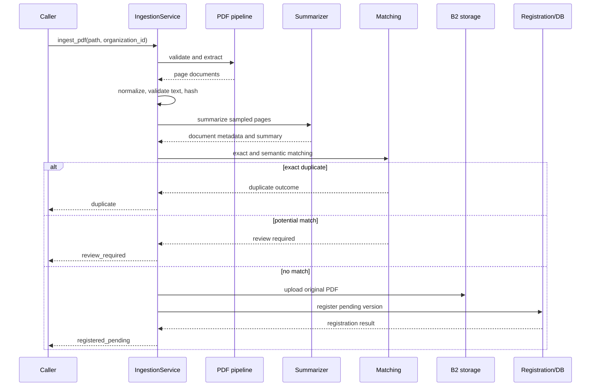

# 9. Document Ingestion

## Orchestrator

`DocumentIngestionService` in `app/services/document_ingestion/ingestion_service.py` coordinates PDF validation, extraction, normalization, hashing, summary generation, duplicate matching, object upload, registration and transaction cleanup. Collaborators are injected (validator, loader, hash service, sampler, summarizer, storage, session factory, matching and registration factories), which allows tests to substitute fakes.

## Workflow

## Outcomes

| Outcome | Meaning | Upload/register |
|---|---|---|
| `duplicate` | Exact file or normalized content match | No |
| `review_required` | Potential semantic/summary match requires review | No |
| `registered_pending` | No match; file stored and pending version registered | Yes |

The organization identifier is validated as a UUID. Extracted pages are normalized before sampling; page metadata is retained; the original PDF is uploaded, not a rewritten PDF. Tests exercise stable organization-scoped duplicate lock keys.

## Failure and cleanup

If upload or registration fails, the service rolls back and attempts object cleanup when applicable. Cleanup errors are retained alongside the primary ingestion failure. Tests cover upload failure, registration failure and cleanup failure.

The tests exercise result fields such as status, filename, file hash, content hash, page count, storage key and optional registration result. The service is not exposed by an implemented HTTP route in the reviewed repository.
