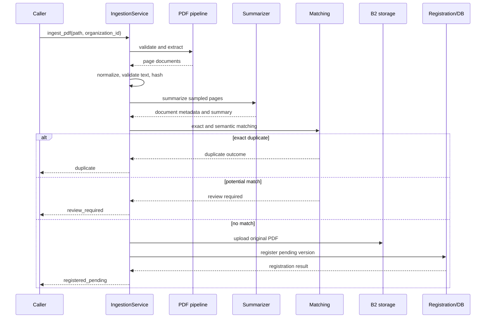

# 9. Document Ingestion

## Orchestrator

`DocumentIngestionService` in `app/services/document_ingestion/ingestion_service.py` coordinates PDF validation, extraction, normalization, hashing, summary generation, duplicate matching, object upload, registration and transaction cleanup. Collaborators are injected (validator, loader, hash service, sampler, summarizer, storage, session factory, matching and registration factories), which allows tests to substitute fakes.

## Workflow

## Outcomes

| Outcome | Meaning | Upload/register |
|---|---|---|
| `duplicate` | Exact file or normalized content match | No |
| `review_required` | Potential semantic/summary match requires review | No |
| `registered_pending` | No match; file stored and pending version registered | Yes |

The organization identifier is validated as a UUID. Extracted pages are normalized before sampling; page metadata is retained; the original PDF is uploaded, not a rewritten PDF. Tests exercise stable organization-scoped duplicate lock keys.

## Failure and cleanup

If upload or registration fails, the service rolls back and attempts object cleanup when applicable. Cleanup errors are retained alongside the primary ingestion failure. Tests cover upload failure, registration failure and cleanup failure.

The tests exercise result fields such as status, filename, file hash, content hash, page count, storage key and optional registration result. The service is not exposed by an implemented HTTP route in the reviewed repository.

## Current two-phase batch ingestion workflow

The active HTTP workflow is implemented by `app/services/document_ingestion/workflow_service.py` and `app/api/v1/endpoints/document_ingestion.py`.

1. Before upload, the manager selects organization-wide visibility and any user-, role-, or department-level allow and deny rules. A document may be assigned to multiple departments, roles, and members; a matching deny always wins.
2. The batch endpoint accepts up to the configured batch limit and streams per-file validation, SHA-256 hashing, PDF extraction/OCR, content hashing, summary generation, duplicate matching and private staging progress.
3. Each successfully analyzed PDF is staged in private object storage with a 24-hour review session. It is not indexed or made available to the assistant yet.
4. The reviewer checks the AI metadata/summary, page count, file/content hashes and matching candidates.
5. The reviewer can reject, ingest as a new document, ingest independently when a match exists, or supersede a matching document with a new version. Indexing begins only after this decision.

Access selections are persisted on the staging session and revalidated against the organization at finalization. The resulting document stores department ACL entries, role/user ACL entries, and an organization-wide visibility flag. The authorization repository enforces those grants when building the member's document catalogue. Organization-wide visibility includes future organization members; role and department grants follow the user's current assignments.

### Fresh database schema

The current schema is defined by SQLAlchemy models. Initialize a fresh PostgreSQL database with python -m scripts.init_database from the backend directory; this creates all registered tables, including the document ACL and ingestion-session allow/deny lists. No incremental migration is provided for this fresh-database workflow. See 07-authorization.md for the exact retrieval formula.
