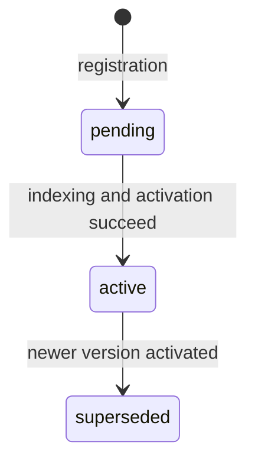

# 14. Document Version Lifecycle

A logical document may have multiple uploaded versions. A version is the unit of indexing and version-specific retrieval. The implementation uses `pending`, `active` and `superseded` statuses. The logical document has a separate archive flag.

## Conceptual state flow

This is a conceptual summary, not a complete list of every allowed transition. Verify transition guards in the service/model before manual intervention.

## Activation

A newly registered version is not searchable as active until indexing completes and activation is committed. When a new version becomes active, the previous active version is marked superseded. Retrieval can distinguish active and historical versions; the multi-query agent validates version-year targets against the available catalogue.

## Archive behavior

Archiving applies to the logical document and excludes its versions from normal retrieval eligibility. Hash lookup may still find archived records so re-uploading the same content does not create an unintended duplicate.

## Recovery

Use `lifecycle_reconciler.py` and `scripts/reconcile_indexes.py` for supported reconciliation. Do not edit database status fields or vector payloads manually without understanding both sides of the lifecycle.