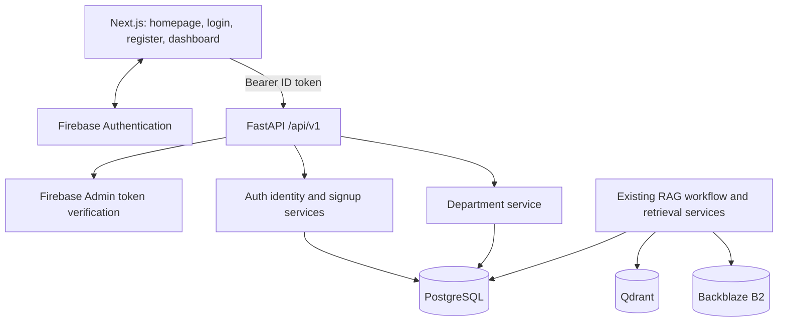

# 30. Current Application Checkpoint

**Product:** SaviraCortex  
**Checkpoint date:** 5 November 2026  
**Repository:** `E:\\SaviraCortex`  
**Status:** Implementation checkpoint; local test evidence is recorded with its scope.

This document records the progression from the previous RAG/backend checkpoint to the current full-stack application state. It is intended to let the next development session continue without confusing earlier roadmap assumptions with work that has since been added.

## 30.1 Where the previous checkpoint ended

The previous technical checkpoint centered on the document intelligence and RAG pipeline:

- Modular PDF ingestion, duplicate detection, document registration and version lifecycle.
- Chunking, embeddings, Qdrant indexing and document-summary indexing.
- Organization-scoped document authorization and hybrid retrieval orchestration.
- LangGraph RAG workflow coordinating retrieval, evidence sufficiency evaluation, bounded retrieval expansion, optional context compression, generation and static validation.
- Request-scoped citation IDs and deterministic validation of generated output.
- Context compression invoked when the accumulated unique retrieved-document count exceeds 15.
- A local workflow E2E runner and synthetic policy PDF fixture.

The earlier roadmap identified the next application-level gap: a FastAPI composition/API layer, Firebase-backed identity, organization onboarding, and a frontend to interact with the platform. It also recorded unresolved retrieval tenant-scope investigation and evaluation work. See [28 — Remaining Implementation Roadmap](28-remaining-implementation-roadmap.md) and [29 — Context Compression](29-context-compression.md).

## 30.2 Work completed since that checkpoint

### A. FastAPI application foundation

The backend now has a runnable FastAPI application at `backend/app/main.py`.

- API title: `SaviraCortex API`.
- Versioned router prefix: `/api/v1`.
- Swagger UI: `/api/v1/docs`.
- ReDoc: `/api/v1/redoc`.
- OpenAPI schema: `/api/v1/openapi.json`.
- Local CORS allows the Next.js development origins on port 3000.
- Router composition includes home, health, authentication and department endpoints.

Start it from `E:\\SaviraCortex\\backend`:

```powershell
uvicorn app.main:app --reload
```

### B. Firebase authentication integration

Firebase Authentication is used for external identity. The frontend has Email/Password, Google and Phone flows. The backend uses Firebase Admin to verify ID tokens.

The verified token is sent to the backend using:

```http
Authorization: Bearer <firebase-id-token>
```

The backend dependency `get_verified_firebase_claims`:
- Requires a Bearer token.
- Verifies it through Firebase Admin.
- Returns verified claims to endpoint/service code.
- Handles invalid, expired and revoked tokens as authentication failures.
- Avoids returning Firebase SDK internals or token contents to the client.

The configured Firebase project was locally checked as `savirarag-development`; the service-account file and backend project configuration were confirmed to reference that project. The service-account JSON is a secret and must remain outside version control and documentation.

Phone auth supports Firebase test phone numbers during development. Real SMS delivery requires Firebase billing to be enabled; test-number verification is not proof of live SMS delivery.

### C. Authentication and organization signup API

Current routes:

| Method | Route | Purpose |
|---|---|---|
| GET | `/api/v1/auth/me` | Return the authenticated SaviraCortex user and organization membership summaries |
| POST | `/api/v1/auth/organizations/signup` | Create the user's SaviraCortex organization and initial membership |

Organization signup:
- Uses verified Firebase claims rather than trusting a client-supplied Firebase UID.
- Validates and trims organization/admin names.
- Supports verified email/Google/phone identity according to the signup service's claim checks.
- Creates the user, organization and initial organization membership with role `admin` within a database transaction.
- Rejects unverified email identities where required and rejects duplicate Firebase UID registration.
- Rolls back on database errors.

The `/auth/me` response includes user identity/profile fields and an array of organizations with `organization_id`, `organization_name` and `role`.

### D. Department management

The existing `OrganizationDepartment` and `OrganizationDepartmentMembership` models were reused. No duplicate department table was introduced.

New implementation modules:
- `backend/app/schemas/v1/departments.py`
- `backend/app/repositories/department_repository.py`
- `backend/app/services/department_service.py`
- `backend/app/api/v1/endpoints/departments.py`
- `backend/tests/test_v1_department_schemas.py`

The versioned router registers the department router.

Routes:

| Method | Route | Access |
|---|---|---|
| GET | `/api/v1/organizations/{organization_id}/departments` | Authenticated member of that organization |
| POST | `/api/v1/organizations/{organization_id}/departments` | Organization owner/admin |

Request body:

```json
{
  "name": "Engineering",
  "description": "Builds and maintains the platform"
}
```

Contract and behavior:
- Name is trimmed and must contain at least two non-whitespace characters; maximum length is 100.
- Description is optional, trimmed and limited to 500 characters; blank descriptions normalize to null.
- Unexpected request fields are rejected.
- Department creation verifies the Firebase UID maps to a registered SaviraCortex user and verifies membership in the requested organization.
- Only `owner` and `admin` membership roles can create departments.
- A duplicate department name within the same organization is translated to HTTP 409.
- Successful creation commits the row and returns its ID, organization ID, name, description and creation timestamp.
- Existing organization-scoped uniqueness is relied on for duplicate prevention.

Important boundary: department service authorization is implemented, but the latest test run did not yet include dedicated service/API integration tests for every authorization branch.

### E. Frontend application

The Next.js frontend now contains these routes:

| Route | Current purpose |
|---|---|
| `/` | Public SaviraCortex homepage |
| `/login` | Firebase login UI |
| `/register` | Firebase registration and organization setup |
| `/dashboard` | Organization dashboard and department management |

The homepage has been redesigned with a dark navy/cyan visual direction, animated orbital centerpiece, floating product concept cards, moving ribbon, capability section and calls to action.

The login UI was visually refined with a more deliberate split-panel treatment and Hugeicons for identity-provider, password visibility and security affordances. Existing email/password, Google and Phone authentication flows remain in the page.

The registration flow supports:
- Email/password account creation and email verification.
- Google popup authentication.
- Phone number and SMS verification using reCAPTCHA.
- Organization name and initial administrator name submission after authentication.
- User-facing handling for common Firebase phone/billing errors.

The dashboard:
- Observes Firebase auth state.
- Calls `GET /api/v1/auth/me`.
- Displays the organizations returned by the backend.
- Loads departments separately for each organization.
- Shows the create-department form only to owner/admin roles.
- Sends the Firebase ID token with department API requests.
- Displays API errors and create success feedback.

The dashboard's role-based form visibility is a UI convenience; backend authorization remains authoritative.

### F. Latest backend test checkpoint

The user ran this command locally on Windows with Python 3.11.15:

```powershell
python -m pytest tests/test_v1_department_schemas.py tests/test_v1_auth_schemas.py tests/services/test_auth_services.py -v
```

**Reported result: 20 passed in 2.33 seconds.**

The 20 tests consist of:
- Department schema validation and normalization.
- Authentication signup schema validation.
- Signup service identity validation and normalization.
- Duplicate Firebase UID and missing UID handling.
- Rollback behavior.
- Authenticated identity/profile organization membership behavior.

This is focused test evidence only. It does not establish that the entire backend suite still passes after the new API work.

## 30.3 Current architecture at a glance



The current frontend/backend identity and organization flows are now in place alongside the previously implemented document/RAG modules. The diagram is a logical view, not a deployment topology.

## 30.4 Files added or materially updated in this phase

### Backend
- `app/main.py`: FastAPI app configuration, CORS and router inclusion.
- `app/core/firebase.py`: Firebase Admin initialization/token verification (existing module used by the API).
- `app/core/dependencies.py`: database and verified Firebase claim dependencies.
- `app/api/v1/router.py`: versioned router registration.
- `app/api/v1/endpoints/auth.py`: current-user and organization-signup routes.
- `app/api/v1/endpoints/departments.py`: department list/create routes.
- `app/schemas/v1/auth.py`: auth request/response contracts.
- `app/schemas/v1/departments.py`: department request/response contracts.
- `app/services/auth/`: signup and identity services.
- `app/repositories/auth_repository.py`: auth persistence operations.
- `app/repositories/department_repository.py`: department persistence queries.
- `app/services/department_service.py`: department membership/role authorization and transaction handling.
- `tests/test_v1_auth_schemas.py`, `tests/services/test_auth_services.py`, `tests/test_v1_department_schemas.py`: focused auth and department schema/service tests.

### Frontend
- `src/app/page.tsx` and `src/app/globals.css`: homepage redesign and animations.
- `src/app/login/page.tsx`: login interface and Firebase provider flows.
- `src/app/register/page.tsx`: registration and organization onboarding.
- `src/app/dashboard/page.tsx`: organization profile and department management.
- `package.json` / `package-lock.json`: frontend dependencies, including Hugeicons.

This list records the principal implementation files, not every asset or supporting module.

## 30.5 What is implemented versus what is verified

| Area | Implementation state | Verification state at this checkpoint |
|---|---|---|
| Existing ingestion/indexing/retrieval/RAG | Implemented in prior milestones | Earlier user-reported tests and smoke tests are documented in docs 21 and 28 |
| FastAPI app and router | Implemented | Local server/API docs were provided for manual verification; this checkpoint does not record an API integration test run |
| Firebase Admin token verification | Implemented | Firebase project/service-account configuration was locally checked; not a production security audit |
| Organization signup and current-user API | Implemented | Focused auth service/schema tests included in 20 passing tests |
| Department schemas and endpoints | Implemented | Schema tests passed; dedicated service/API integration tests remain |
| Homepage/login/register/dashboard UI | Implemented in source | No frontend build, lint or browser visual regression result recorded here |
| Department PostgreSQL persistence | Service transaction code implemented | Real database create/list flow not confirmed by the 20-test command |
| Real SMS OTP delivery | Configuration-dependent | Firebase test phone numbers used in development; real SMS billing/production delivery remains separate |

## 30.6 Known limitations and follow-up work

1. **Department service tests:** add tests for owner/admin creation, member-forbidden behavior, missing membership, unregistered Firebase user, duplicate-name conflict and rollback.
2. **Department API integration tests:** test authenticated GET/POST routes with an isolated database and verified-claims dependency override.
3. **Database schema check:** verify the target PostgreSQL database has the existing department table and organization/name unique constraint. A SQLAlchemy model declaration alone does not prove the live schema is current.
4. **Frontend verification:** run `npm install`, `npm run lint` and `npm run build`; then manually verify homepage, login, registration and dashboard in a browser.
5. **Dashboard auth hardening:** review token refresh/retry behavior and auth-listener race handling before considering the dashboard production hardened.
6. **Tenant isolation:** continue the previously identified retrieval-scope investigation; do not interpret the earlier smoke test as a tenant-isolation pass.
7. **Citation/document API:** trusted citation resolution and protected document viewing are still separate roadmap work.
8. **Chat UI/API:** the current frontend routes do not yet constitute a completed end-user chat experience connected to the RAG graph.
9. **Evaluation:** complete and report the retrieval benchmark and plan the end-to-end answer-quality evaluation.
10. **Deployment/security:** review secret management, allowed origins, environment separation, logging, monitoring, rate limits and operational readiness before production.

## 30.7 Suggested next development sequence

1. Add department service tests and endpoint integration tests.
2. Run the focused backend suite and then the full backend suite.
3. Verify department create/list against the configured local PostgreSQL database.
4. Run frontend lint/build and fix any type or runtime errors.
5. Browser-test the complete Firebase → organization signup → dashboard → department create/list journey.
6. Continue retrieval tenant-scope investigation and evaluation work.
7. Implement the authenticated chat API/UI and protected citation/document viewing according to the existing RAG contracts.

## 30.8 How to resume

Start the backend:

```powershell
cd E:\\SaviraCortex\\backend
uvicorn app.main:app --reload
```

Start the frontend in a second terminal:

```powershell
cd E:\\SaviraCortex\\frontend
npm run dev
```

Open:
- Frontend: `http://localhost:3000`
- API docs: `http://localhost:8000/api/v1/docs`

Re-run the last verified focused backend test command before making further changes. Treat all verification results in this document as checkpoint-specific and user-reported unless a later test run updates them.
