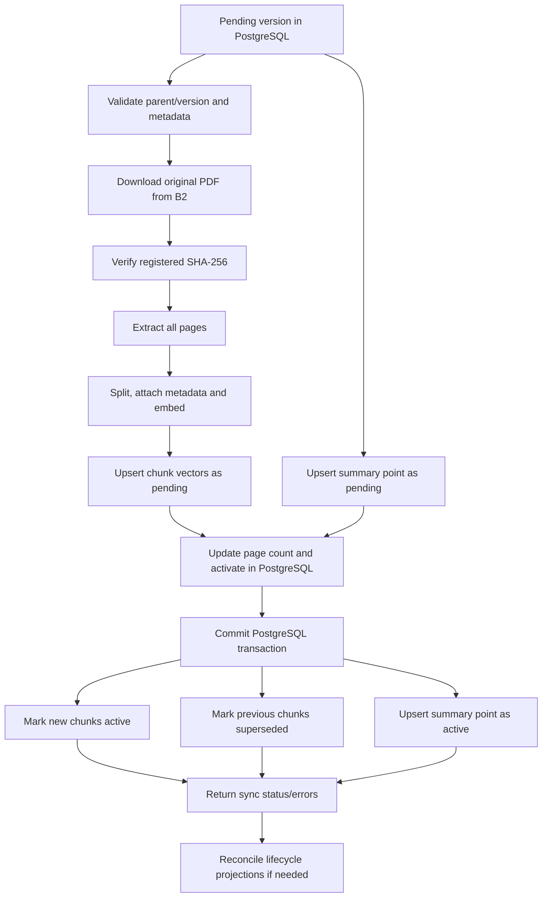

# Indexing Flow

Before a confirmed commit, indexing failures attempt to remove newly written Qdrant chunks/summary and roll back PostgreSQL. The original B2 PDF is retained. If commit outcome is uncertain, external points are preserved. Post-commit synchronization failures are reported rather than rolling back the database activation.
