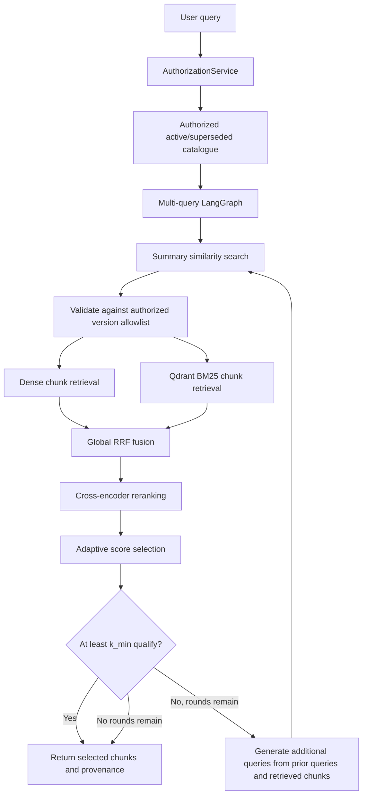

# Retrieval Flow

The diagram reflects the current retrieval orchestrator: PostgreSQL-derived authorization catalogue, summary-based candidate generation, candidate-scoped chunk search, global fusion/reranking and adaptive query expansion.

The current orchestrator calls `AuthorizationService` directly; the separate Redis authorization cache helper is not wired into this path.
